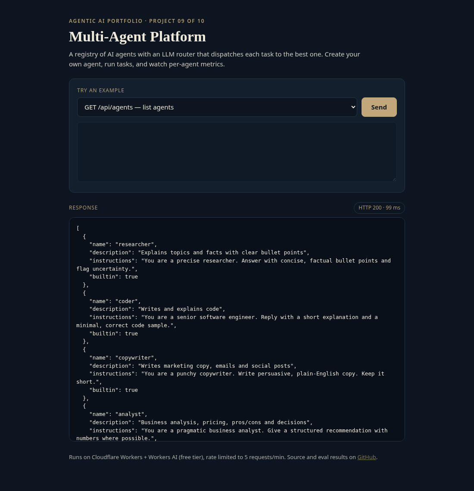
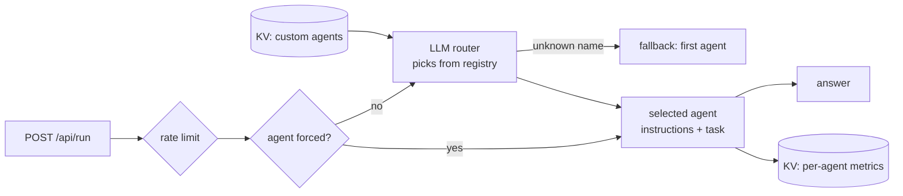

# agent-09-multi-agent-platform

**Multi-Agent Platform: registry, LLM router, metrics**

**Live demo:** https://agent-09-multi-agent-platform.braylo777.workers.dev



## What it is
A small agent platform: a registry of built-in and user-created agents, an LLM router that dispatches each task to the best agent, and per-agent usage metrics. Project 9 of a 10-part agentic AI portfolio.

## Architecture


## How it works
- `src/platform.js`: 4 built-in agents (researcher, coder, copywriter, analyst), custom agents (validated, capped at 30), JSON router with fallback, metrics.
- `src/index.js`: `/api/run`, `/api/agents` (GET/POST), `/api/metrics`.
- Runs serverless on Cloudflare Workers with the free Workers AI tier (`@cf/meta/llama-3.3-70b-instruct-fp8-fast`); 5 requests/min per IP keeps the demo free.

## Eval results
Measured against the **live** deployment with real model calls (`node evals/run.mjs`), run 2026-10-28. Raw per-case output: [`evals/results.json`](evals/results.json). Small sample sizes, kept small to stay inside the free daily model quota, so read these as indicative, not definitive.

| Metric | Result |
|---|---|
| Routing accuracy (20 labelled tasks, 5 per agent) | 20/20 (100%) |
| Router fallbacks | 0 |
| Latency p50 / p95 (end-to-end HTTP) | 5984 ms / 9660 ms (n=20) |

## Tests
10/10 unit tests pass (`npm test`, Node 20+, the LLM is mocked so they run offline).

## Run it
```bash
npm install
npm test               # offline unit tests
node evals/run.mjs     # live evals (BASE=http://localhost:8787 for local)
npx wrangler dev       # local; Workers AI via your Cloudflare login
npx wrangler deploy    # free tier, no paid API keys
```

## License
MIT
